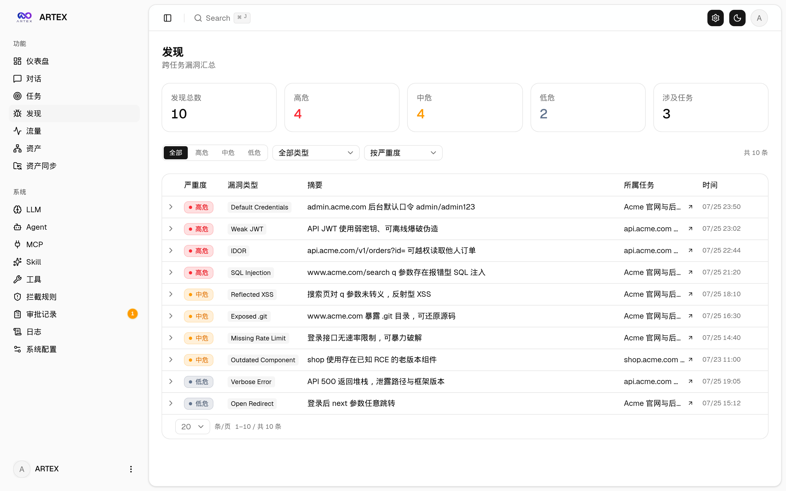
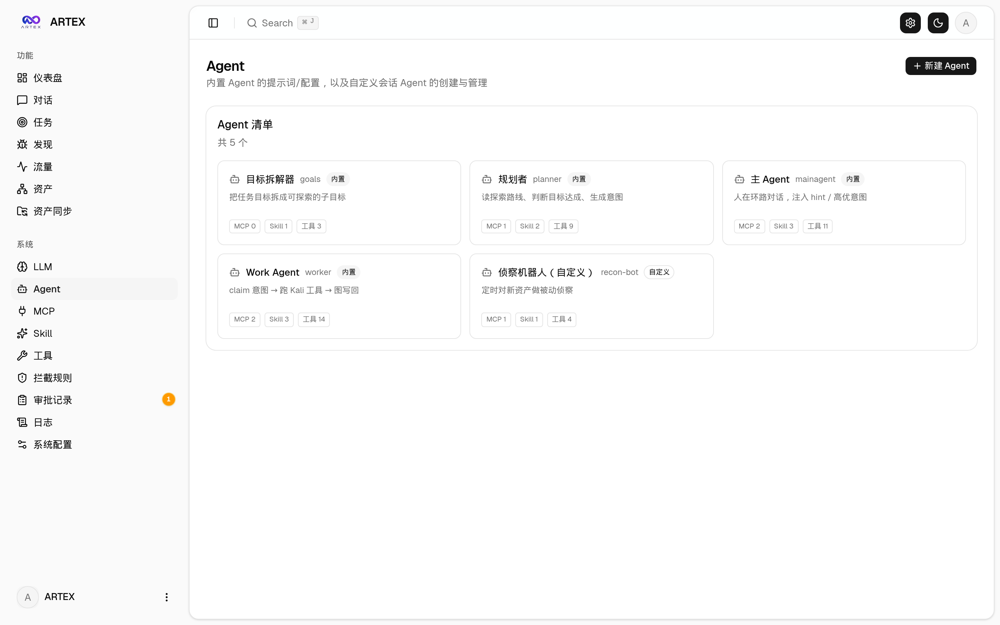

<div align="center">

# AegisForge

All-in-one security workbench — autonomous penetration testing + reverse-engineering
orchestration + visual workflow engine, in one Web GUI.

Merged from: ARTEX (dual-upstream Go base) · dsh workflow engine (MIT) ·
unirev routing (GPL-3.0, vendored) · self-built pj_* tool suite · Claude Agent SDK runner.

</div>

---

## What it is

AegisForge combines six open-source lineages into a single self-hosted workbench:

- **Go base (ARTEX dual-upstream merge)** — autonomous pentest loop (planner/worker),
  guard approval chain, four-layer tool registry, mitm traffic interception, PG16 storage,
  LLM profile pool. Merged from [ARTEX](https://github.com/Autumn-27) (BaaRai English line +
  RuoJi6 Chinese line, module sets mostly disjoint, union taken).
- **flowd (Node/Fastify)** — visual workflow daemon. The engine (`src/shared/*`) is vendored
  from dsh-workflow-lite (MIT) unchanged; the 7 host couplings were rewritten. Runs the
  **Claude Agent SDK** as an embedded runner, so workflow graphs execute on an LLM agent
  while the Go side keeps its own pentest loop — both surfaces show up in one runs view
  (`runtime: go | sdk`).
- **toolbridge** — Go is the single source of truth for tools. `GET /api/tools/registry`
  + `POST /api/tools/invoke` pass every call through the same guard/approval gate; an MCP
  bridge (`flowdbridge.exe`, 20 `pj_*` tools) mirrors them into the SDK path.
- **pj_* tool suite** — 20 self-built Go tools for reverse-engineering workflows
  (route/case/runbook/sample/scan/decompile/bindiff/facts/patch/crypto/decode/keygen/report/…).
  Pure-Go static analysis (PE/ELF, entropy, packer heuristics, strings) with graceful
  degradation when IDA/Frida are absent; `pj_patch` never degrades (orig_hex + rollback enforced).
- **unirev routing** — vendored testdata + real Go router: scope gates → 8 signal-matched
  routes (R-CTF-WEB/PWN/APK/PE/WEBJS/REBUILD/CROSS/GATE-REJECT) → evidence bundles that
  import/export across tools.
- **Web GUI (Next.js)** — dashboard, sessions, runs, React-Flow workflow canvas, tool market,
  **SDK approval center**, LLM profile management, interception approvals.

## Architecture

```
                  ┌────────────  Web GUI (Next.js :3000)  ────────────┐
                  │ dashboard / runs / canvas / approvals / profiles  │
                  └────────────────────────┬──────────────────────────┘
                                           │ /api/* proxy + JWT auth
        ┌──────────────────────────────────┼──────────────────────────────┐
        ▼                                  ▼                              ▼
┌── Go base (artex :8787) ──┐   ┌── flowd (Fastify :8899) ──┐   ┌── flowdbridge (:8901) ──┐
│ pentest loop / guard      │◄──│ workflow engine (MIT)     │──►│ 20 pj_* tools (Go)       │
│ tool registry (SSOT)      │   │ Claude Agent SDK runner   │   │ registry + invoke        │
│ mitm proxy (:8788)        │   │ profiles hot-reload       │   └──────────────────────────┘
│ PG16 (5432)               │   │ approvals / notify / mirror│
└───────────────────────────┘   └───────────────────────────┘
```

## Ports

| Port | Service | Notes |
|---|---|---|
| 3000 | web (next dev) | `/api/*` proxies to :8787 |
| 8787 | Go base (artex) | auth: first-run `/api/auth/init` sets admin password |
| 8788 | artex traffic proxy | mitm capture |
| 8899 | flowd | workflow runs, approvals, profiles |
| 8901 | flowdbridge | 20-tool registry |
| 5432 | PostgreSQL 16 | service `postgresql-artex`, local dev only |
| 8080 | — | leave free (Burp Suite default) |

## Quick start (Windows)

```powershell
# 1) PostgreSQL 16 (winget install PostgreSQL.PostgreSQL.16), then:
powershell -NoProfile -ExecutionPolicy Bypass -File ops\start-artex.ps1   # Go base on :8787

# 2) toolbridge (20 pj_* tools on :8901)
go build -o bin\flowdbridge.exe ./cmd/flowdbridge
$env:AF_BRIDGE_ADDR='127.0.0.1:8901'; $env:AF_BRIDGE_DATA='C:\aegisforge\data'; .\bin\flowdbridge.exe

# 3) flowd (workflow daemon on :8899)
cd services\flowd; npm run build
$env:AF_DATA_DIR='C:\aegisforge\data\flowd'; $env:AF_PORT='8899'
$env:AF_CORS='1'; $env:AF_TOOLS_BRIDGE_URL='http://127.0.0.1:8901'
$env:AF_APPROVALS='1'; node lib/index.mjs

# 4) web
cd web; npm run dev    # http://localhost:3000
```

Health check — one shot, read-only, 16 items:

```powershell
powershell -NoProfile -ExecutionPolicy Bypass -File ops\doctor.ps1   # add -Json for machine output
```

Optional env switches: `AF_UNATTENDED_TOOLS=1` (controlled environments), `AF_PERMISSION_MODE=default`
(makes the approval center observable — acceptEdits auto-approves cwd-safe commands),
`AF_NOTIFY_DINGTALK|FEISHU|TELEGRAM|WEBHOOK` (run-completion notices), `AF_MIRROR_URL` +
`ARTEX_MIRROR_TOKEN` (mirror run terminals into PG `workflow_runs`).

## Repository layout

```
cmd/artex/           Go main (pentest base)      cmd/flowdbridge/   MCP tool bridge
pkg/pjtools/         20 pj_* tools + unirev router (testdata-driven)
pkg/toolbridge/      tool registry HTTP surface  pkg/flowdproxy/    flowd reverse proxy
server/  db/         handlers + PG schema (58 tables, idempotent)
services/flowd/      workflow daemon — src/shared/ (vendored MIT engine, unchanged)
                     src/adapters/ (runner/approvals/profiles/notify/mirror), 21 vitest cases
web/                 Next.js GUI (canvas, approval center, runs view)
ops/                 start-artex.ps1, doctor.ps1, install-unirev.ps1 (idempotent .bak/Restore)
data/                runtime state (not committed)
```

## Screenshots

| Dashboard (overview / token usage / activity stream) | Task list |
| :---: | :---: |
|  |  |

| Task · execution (sessions / tool calls) | Exploration graph |
| :---: | :---: |
|  |  |

| Findings | Assets |
| :---: | :---: |
|  |  |

| Interception approvals | Agent management |
| :---: | :---: |
|  |  |

---

## Scope boundary

This workbench collects workflow-engine mechanics, reverse-engineering tooling, and
autonomous-pentest infrastructure only. No prompt-injection / jailbreak content from any
upstream is included or maintained here.

## License and disclaimer

### Open source license

This project is licensed under the **GNU Affero General Public License v3.0 (AGPL-3.0)**; see the [LICENSE](LICENSE) file in the repository root for the full terms.

This means anyone may freely use, modify, and distribute this project, but **derivative works must also be open-sourced under AGPL-3.0**; in particular, **if you modify this project and provide it to users over a network (e.g. deployed as an online service), you must also make the corresponding complete source code available to those users**.

> ⚠️ **Important**: the open source license itself does not restrict how the software is used. The "Usage restrictions" and "Disclaimer" below are additional terms and a solemn statement from the maintainers to users, so please abide by them.

**AegisForge is an offensive-security tool. Use it only against systems you own, or that you are explicitly authorized to test (your own lab, your organization's assets, or a bug bounty / vulnerability disclosure program's targets within its published scope and rules of engagement). Any use without authorization is a violation of these terms.**

### Permitted use

- **Read, learn, and study this project's source code**;
- Run it against **systems you own** or in **isolated lab environments**;
- Run it against **authorized bug bounty / vulnerability disclosure program targets**, within their published scope and rules of engagement;
- Academic research and code review.

### Prohibited actions

- **It is strictly forbidden to scan, probe, exploit, or attack any website, online service, or networked system without the explicit authorization of its owner**;
- It is strictly forbidden to test outside a program's published scope, or in violation of its rules of engagement;
- It is strictly forbidden to use this tool for illegal intrusion, data theft, extortion, denial of service, or any destructive or criminal activity;
- It is strictly forbidden to use this tool for anything that violates the laws and regulations of your country/region.

### Compliance responsibility

Users must comply with all laws and regulations of their country/region regarding cybersecurity, data protection, and computer crime. **All legal liability and consequences arising from the use of this tool are borne by the user.**
